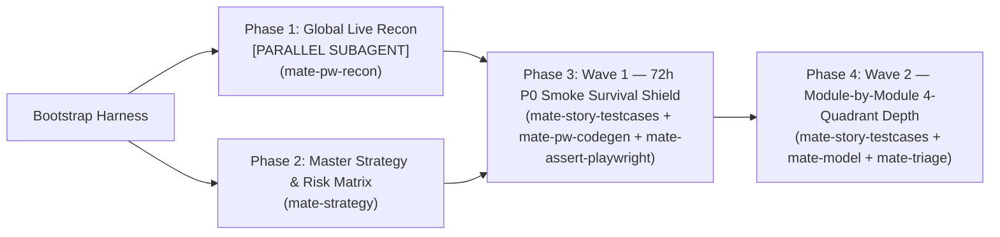

# 🚀 Workflow: `/mate-flow-zero-to-one` (Zero Testing to Production Protection)

Use this workflow when a QA team lands in a project that has **no Test Strategy, no Test Plan, no documented test cases, and no automation**, while the application is **already running in production/staging with real users** (including when M.A.T.E. is installed in a standalone QA folder outside the frontend/backend repositories).

> ⚡ **Parallel Sub-Agent Execution (`[PARALLEL_SUBAGENT_ELIGIBLE]`):**  
> If the host environment supports sub-agents, **Phase 1 (Global Live Browser Recon)** can run in an isolated sub-thread to crawl routes, network traffic, and ARIA snapshots, while the primary cockpit thread drafts **Phase 2 (`TEST-STRATEGY.md`)**. The sub-agent returns only populated `src/pages/*.page.ts` stubs and discovered API routes. See [`docs/SUBAGENTS_AND_PARALLEL_EXECUTION.md`](../docs/SUBAGENTS_AND_PARALLEL_EXECUTION.md).

---

## Phase 1: Bootstrap Standalone QA Harness & Global Live Recon (`mate-core` + `mate-pw-recon`)
1. Ensure the project has the M.A.T.E. standalone execution harness (`playwright.config.ts`, `tsconfig.json`, `.env.example`, and `package.json` scripts). Copy `.env.example` to `.env` and set `BASE_URL` to the live staging/production URL.
2. Check `@playwright/cli` availability. If NOT installed, **STOP** and ask the user:  
   *"We don't have `playwright-cli` available in this project. How would you like to proceed?"* (Options: 1. Install `@playwright/cli` [Recommended], 2. Use Browser MCP, 3. Inspect Source Code, 4. Provide DOM Snippets).
3. Open the live application via `playwright-cli open <BASE_URL>` (`mate-pw-recon`) or the selected fallback method.
4. Crawl the primary navigation, user roles, forms, and workflows using `playwright-cli snapshot` (or MCP/source inspection).
5. Inspect `playwright-cli network` during navigation to discover the underlying backend API endpoints (`REST`/`GraphQL`), auth headers, and status codes—even if Backend has no Swagger/OpenAPI docs (`references/network-api-discovery.md`).
6. Populate the **System Modules** and **Architecture Stack** tables inside `MATE-PROJECT-MAP.md`.

---

## Phase 2: Master Test Strategy & Business Risk Matrix (`mate-strategy`)
1. Generate the Master Test Strategy (`npx mate-sdt strategy` ➔ `docs/TEST-STRATEGY.md`) and the initial Test Plan (`npx mate-sdt plan initial-onboarding` ➔ `docs/test-plans/TP-initial-onboarding.md`).
2. Score every discovered business module using the **M.A.T.E. Risk Formula**:
   $$\text{Risk Score} = \text{Business Impact } (1\text{–}5) \times \text{Failure Probability } (1\text{–}5)$$
3. Classify modules into:
   - **P0 (Score 15–25 — Survival/Revenue Critical):** Must be covered immediately in **Wave 1 (Smoke Shield)**.
   - **P1 (Score 8–14 — High Importance):** Scheduled for **Wave 2** sprint-by-sprint deepening.
   - **P2 (Score 1–7 — Secondary/Cosmetic):** Covered after P0/P1 stabilization.

---

## Phase 3: Wave 1 — Build the 72-Hour P0 Smoke Survival Shield (`mate-story-testcases` + `mate-pw-codegen` + `mate-assert-playwright`)
> **Why Wave 1 First?** Never spend 3 weeks writing 40 edge cases for Module #1 while Modules #2–#6 in production have zero tests. Build the horizontal P0 Smoke Shield first!  
> **⚠️ Test-Design-First Mandate (`MATE-INVARIANT-08`):** Never write `.spec.ts` automation code before designing test cases! Even for Wave 1, you must first document what you are testing, what is automated in UI vs. API, and what remains for manual/exploratory verification.

1. **Design P0 Smoke Test Cases (`mate-story-testcases`):**
   - Select the top **5 to 8 P0 Golden Paths** across the application (e.g., Login, Core Search/Catalog, Creation/Cart, Checkout/Payment, Critical API Health).
   - Generate `docs/test-cases/TC-smoke.md` and `.csv` using `npx mate-sdt cases smoke` (or `mate-story-testcases`).
   - Apply the **Decision Engine**: tag which steps are `[AUTOMATE_UI]` (`@smoke @p0`), which are `[AUTOMATE_API]` (sub-second health/auth checks), and which fallbacks are `[MANUAL_TEST]` or `[EXPLORATORY_CHARTER]`.
2. **Live Reconnaissance (`mate-pw-recon`):**
   - Walk through each P0 Golden Path in `playwright-cli`, extracting semantic locators (`getByRole`, `getByLabel`, `getByTestId`).
3. **Scaffold SOLID Architecture (`mate-assert-playwright`):**
   - Encapsulate shared widgets in `src/components/*.component.ts` (`BaseComponent`), pages in `src/pages/*.page.ts` (`BasePage`), and register them in `src/fixtures/mate.fixtures.ts` and `MATE-PROJECT-MAP.md`.
4. **Automate the Smoke Suite (`mate-pw-codegen` + `mate-assert-api`):**
   - Automate the `@smoke @p0` suite (`tests/e2e/smoke.spec.ts` and `tests/api/health.spec.ts`) tracing back directly to `TC-smoke.md`.
5. **Verify Safety Net:**
   - Run `npm run test:smoke` and `npx mate-sdt gate` (verifying `GATE-01-CONTEXT` through `GATE-04-SOLID-AUDIT` and writing `.mate/harness-state.json`). The team now has an automated 2-minute production safety net!

---

## Phase 4: Wave 2 — Iterative 4-Quadrant Deepening & Anti-Greenwashing (`mate-story-testcases` + `mate-model` + `mate-triage`)
Once Wave 1 (`npm run test:smoke`) is active, iterate through each module in priority order (`P0` ➔ `P1` ➔ `P2`) using `/mate-flow-user-story`:
1. **Model (`mate-model`):** Author `specs/[module].mate-spec.md` with Finite State Machines, **Explicit Forbidden Transitions**, and `<invariants>`. Validate with `npx mate-sdt validate`.
2. **4-Quadrant Test Cases (`mate-story-testcases`):** Run `npx mate-sdt cases <module>` to generate `docs/test-cases/TC-[module].md` and `.csv` covering `HAPPY_PATH`, `BORDER_CASE`, `NEGATIVE_PATH`, and `STATE_TRANSITION`.
3. **Verify & Automate (`mate-pw-recon` + `mate-pw-codegen` + `mate-assert-api`):**
   - Validate border and negative cases live in `playwright-cli`.
   - Automate UI E2E tests (`tests/e2e/[module].spec.ts`) and API Contract tests (`tests/api/[module].spec.ts`).
   - **Anti-Greenwashing Enforcement:** Any pre-existing bug discovered in the live app is **automated with its real expected assertion**, marked with `test.fail(true, 'BUG-XXX: ...')`, and documented via `npx mate-sdt bug <module>`.
4. **Black-Box Pillar T & E (`mate-threat` + `mate-performance-k6` + `mate-explore`):**
   - Execute multi-actor concurrency checks (`playwright-cli -s=actor1`, `-s=actor2`), k6 SLA scripts (`npx mate-sdt k6`), and 30-min human exploratory charters (`npx mate-sdt charter <module>`).

---

## 🧵 Session Workbench & Black-Box Handoff Protocol

1. **Start Isolated Session:** `npx mate-sdt session start <flow-id> --module=<module> --stage=<initial-stage>`
2. **Record Raw Events (Window $K=5$):** `npx mate-sdt session event <flow-id> "[OBSERVED | ISO] ..."`
3. **Stage Transition (Auto-Compaction + `mate.handoff/v1`):** `npx mate-sdt session advance <flow-id> --stage=<next> --to=<next-skill> --digest="..."`
4. **JIT Context & Consolidation:** Run `npx mate-sdt context <module>` before each stage and `npx mate-sdt context <module> --consolidate` + `npx mate-sdt gate` at completion.

---

## ⚙️ Execution Plan, Closed-Loop Gate & Independent Review

1. **Persist Execution Plan:** Create/update `.mate/exec-plans/active/<flow-id>.md` (move to `.mate/exec-plans/completed/` upon completion).
2. **Closed-Loop Verification:** Run `npx mate-sdt gate --loop` (max 5 iterations) and `npx mate-sdt gc` to refresh `docs/QUALITY_SCORE.md`.
3. **Independent Agent Review Pass:** Trigger an independent reviewer pass (`mate-core` / `mate-maintenance`) to audit the diff against `specs/<module>.mate-spec.md` and `docs/QUALITY_SCORE.md`.

## Zero-Assumption Escalation & Sub-Agent Isolation Protocol

- **Ask, Never Guess (`STATUS: BLOCKED_ON_USER_INPUT`):** Inspect local context (`MATE-PROJECT-MAP.md`, `specs/`, code) and live browser/API responses first. Never invent business thresholds, auth boundaries, or SLA numbers. Tag any genuine requirement gap as `[TBD: <exact question for PO/Dev/QA>]` inside `## Open Questions for Human QA`, finish all unblocked work, and halt when `npx mate-sdt validate` or `npx mate-sdt gate` returns `STATUS: BLOCKED_ON_USER_INPUT` to ask the human.
- **Sub-Agent Context Isolation (`--subagent` & `mate.handoff/v1`):** When delegating to a sub-agent or running a multi-stage pipeline (Reader/Extractor -> Spec Scorer -> Code Writer -> Independent Reviewer), build a scoped prompt via `npx mate-sdt context <module> --subagent <skill-name>` (`.mate/subagent-prompt-<module>-<skill>.md`). Pass only the structured `mate.handoff/v1` digest between stages (or run `--compact` in single-agent IDEs) so raw exploratory noise never pollutes downstream context windows.
